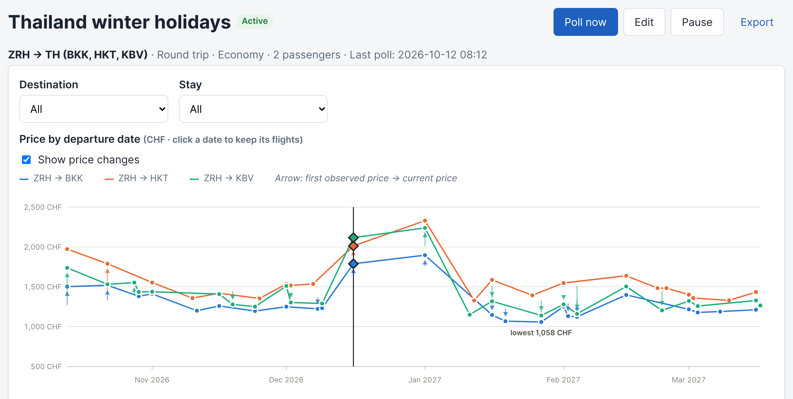
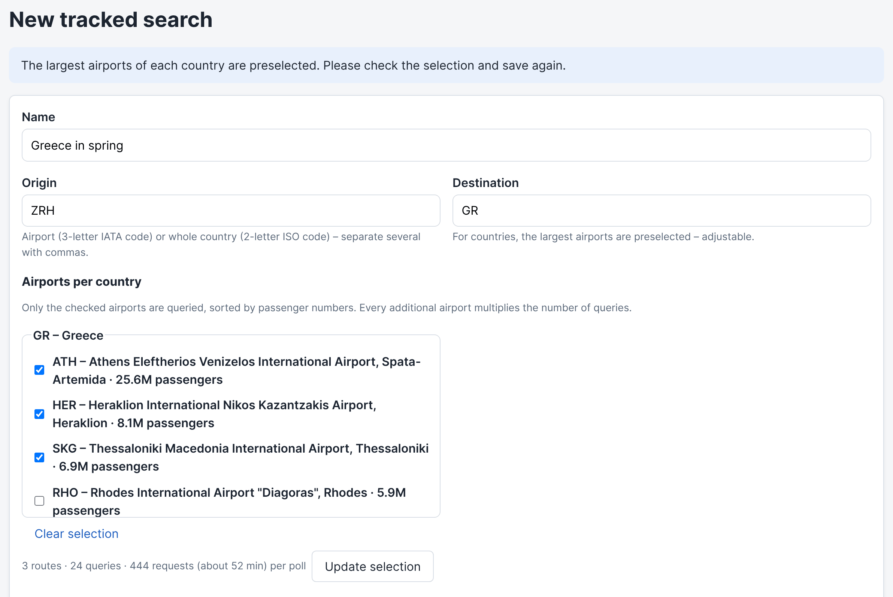
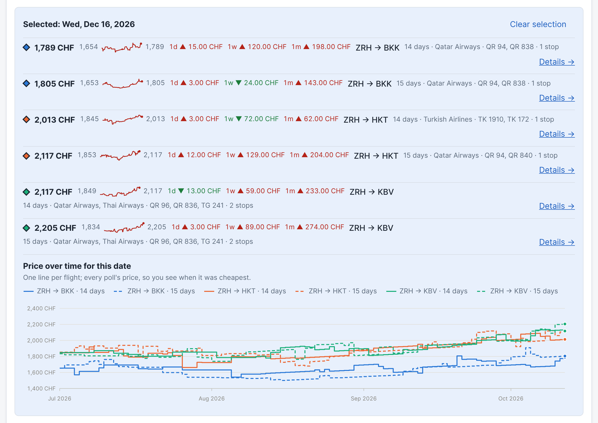
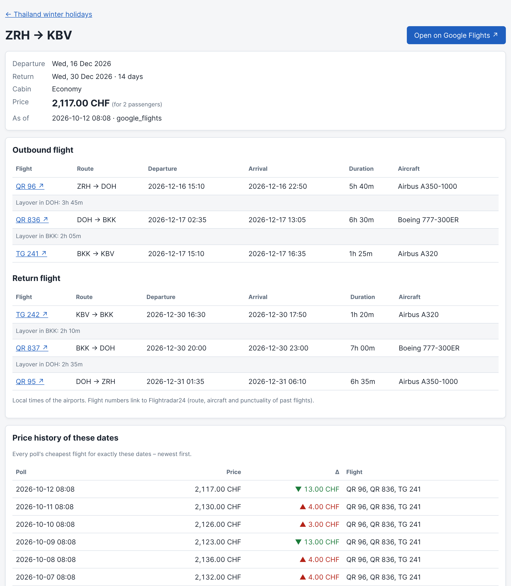
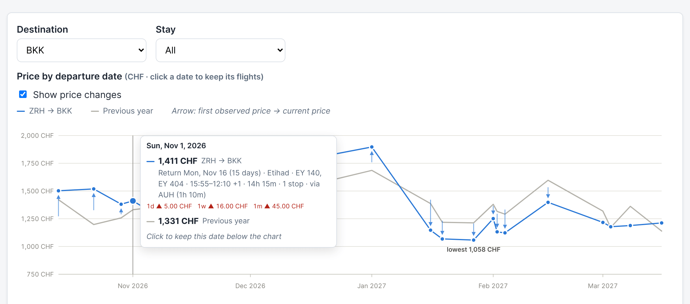
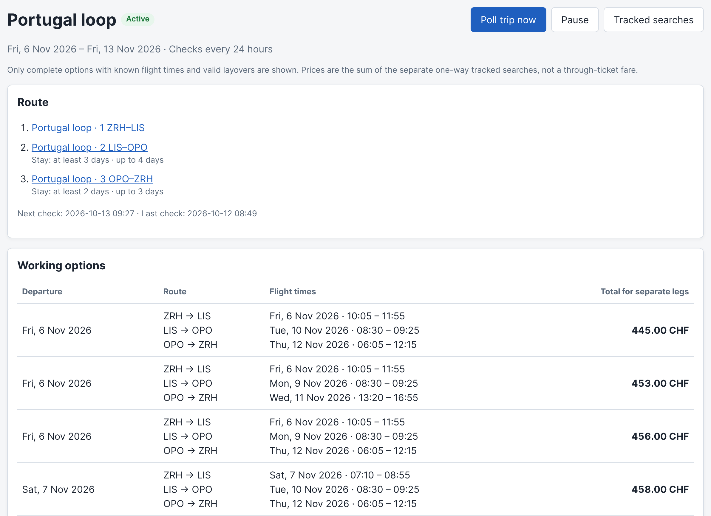
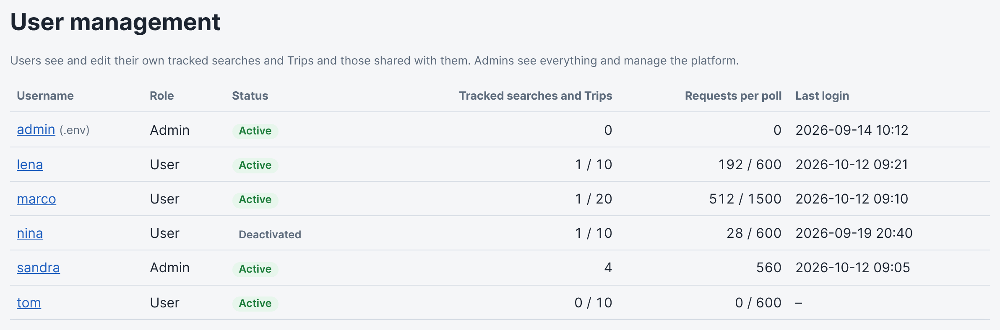
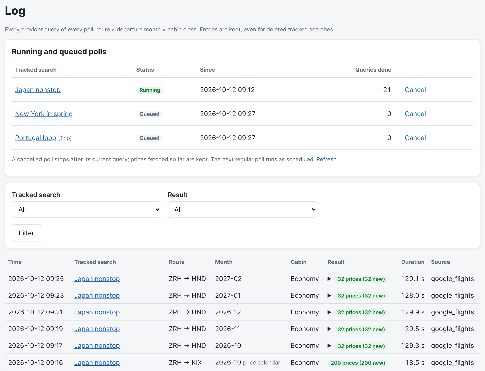
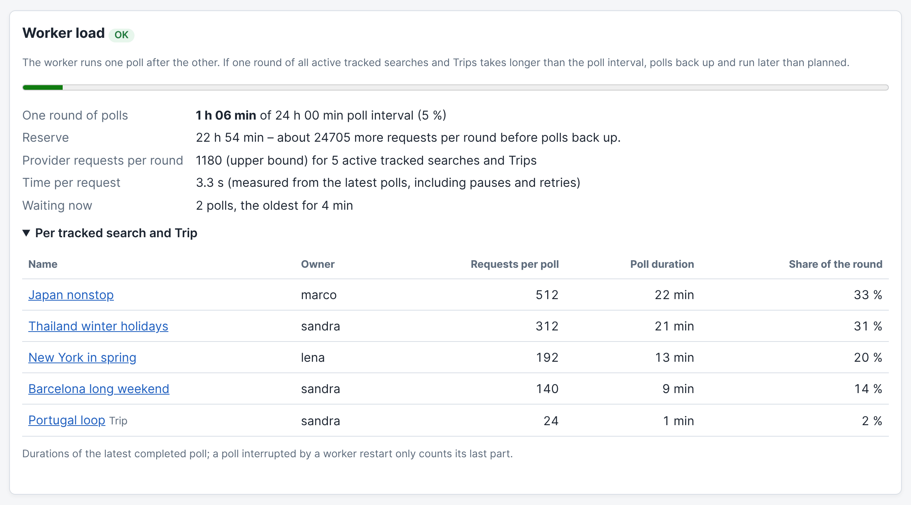

# Plane and simple ✈

**Plane and simple** is a self-hosted flight price tracker. Create *tracked searches* – airports
or whole countries, round trip or one-way, stay lengths, cabins, passengers – and a background
worker polls Google Flights on a schedule and keeps every price it sees. For every departure date
you get the cheapest fare with its flights, how it developed (*when to buy*) and the same dates a
year earlier. The Trip Planner finds the cheapest combinations of up to eight one-way flights;
several users share searches within per-user limits. English and German UI, runs with Docker
Compose, built with Claude.



<sub>Screenshots: the real web UI with invented demo data.</sub>

Design and conventions: [architecture.md](architecture.md) · data model: [datamodel.md](datamodel.md)
· backlog: [userstories.md](userstories.md).

## Features

- **Tracked searches** from and to airports or whole countries (the largest airports by passenger
  numbers are preselected), round trip or one-way, stay lengths, cabins, passengers, direct-only.
- **Complete prices:** every Google Flights result sorted by price, not just the first page. Each
  poll reads Google's price calendar first and queries half of its departure days on the
  cheapest days of the month, the other half on fixed days for a continuous history.
- **Price chart** per departure date with price changes and the previous year; a clicked date
  lists its flights with 1-day / 1-week / 1-month changes and their price over time – *when to
  buy*.
- **Flight details:** segments, layovers, aircraft, Flightradar24 and Google Flights links, every
  poll's price for these dates; optionally the return flight (one more request per price).
  Warnings for airport changes, short, overnight and long layovers.
- **Price alerts by mail** per search (optionally per route and cabin): once per flight and
  price drop. Mail via any SMTP account (presets for Gmail, Outlook, iCloud, Infomaniak, …),
  also for welcome mails and "Forgot password?"; Mailpit catches all mails in the dev stack.
- **When to book:** a rule-based reading of every flight's prices (lowest seen, above average,
  rising …) – optionally explained by an AI (local Ollama, any OpenAI-compatible API or
  Claude), which can also turn a plain-language travel wish into a draft tracked search.
  Admins see every AI request in a usage log, stage by stage: what was sent, the model's
  thinking, the answer as received (also when it was cut off) and what the app made of it.
- **What changed:** after every poll a short report – cheapest flight against the poll before,
  new lowest prices, biggest drops and rises, unusually cheap prices – on the tracked search's
  page and as a line in the list; after a notable poll the AI (optional) sums it up in two or
  three sentences, also in price alert mails. A price far below what its route usually costs
  (possibly an error fare) is marked and mailed right away.
- **[Trip Planner](#trip-planner)** for routes of 2–8 one-way legs with stays in between.
- **[Users](#users-and-operation)** with sharing and per-user limits; Poll Log and worker load
  for admins.
- Clear a search's price history, JSON export/import, append-only history, self-hosted with
  Docker.







There is no historical backfill – no free source offers past fares; the previous-year
comparison fills up through the app's own tracking:



## Trip Planner

Open **Trip Planner** to build a route from 2–8 airport-to-airport legs, each its own one-way
tracked search listed under the Trip. Set a date window from first departure to final arrival (up
to 60 days) and the min/max stay before each following leg. The worker polls the first leg on
every day of the window, then only dates that can connect to a known arrival.



Options are the 200 cheapest current combinations with valid connections – the sum of separate
one-way fares, not a through-ticket: self-transfers are not protected. The planner needs flight
times, so it requires Google Flights. A Trip is paused, archived, cleared or deleted together with
its legs.

## Users and operation

The admin from `.env` (`ADMIN_USERNAME` / `ADMIN_PASSWORD_HASH`) always works and cannot be
locked out from the UI. Admins create further users under **Users** (top bar):

- **Users** see and fully edit their own tracked searches and Trips and can share each one with
  other users, view-only or view-and-edit. Editors can change, pause and poll, but not archive,
  delete or share. Admins see and manage everything.
- **Deactivating or deleting** a user pauses their tracked searches and Trips – except those
  another active user may edit. A deleted user's tracked searches and Trips go to the admin
  from `.env`.
- **Limits** per user (admins have none): at most `MAX_SEARCHES_PER_USER` (10) tracked searches
  and Trips and `MAX_REQUESTS_PER_USER` (600) provider requests per poll for all of them – the
  request budget is what really costs. Defaults under **Settings → Platform Settings**,
  changeable per user.



The **Poll Log** lists running and queued polls and every provider query; whoever may edit a
tracked search can cancel its poll there (prices fetched so far are kept).



The single worker runs one poll after the other, so the real ceiling is time: **Platform
Settings → Worker load** shows how long one round of all polls takes (measured) against the poll
interval, how many more requests fit before polls back up, and each search's share, together
with the **poll schedule**: every tracked search and Trip has a start time of its own (new ones go
into the largest free gap). The timeline replaces a load bar; "Edit schedule" lets admins drag its
bars or type the start times right there, or spread all polls evenly.



## Quick start (devcontainer)

1. Open the folder in VS Code → "Reopen in Container". After any change to `.devcontainer/`, run
   **"Dev Containers: Rebuild Container"** (a plain reopen keeps the old containers). Claude Code
   is installed automatically and the login persists across rebuilds (volume `claude-config`).
2. Everything else happens automatically:
   - `.env` is generated with random secrets (`python -m flighttracker.cli init-dev-env`); the
     dev login is printed and noted at the top of `.env`.
   - `migrate` creates the schema and imports the airports.
   - `web` and `worker` run in their own containers and restart on every change of the code or
     `.env` – no rebuild, no manual restart.
3. Open http://localhost:8000. VS Code forwards the port from the `web` container (tab "Ports";
   if 8000 is taken locally, VS Code picks another port and shows it there).

Logs and restarts from the devcontainer terminal:
`docker compose -p planeandsimple_devcontainer logs -f web worker migrate` (project name: see
`docker compose ls`).

Optional: enter a Wikidata contact (your URL or e-mail) under **Settings → Platform Settings**
and start the airport import there, so that countries preselect their largest airports by
passenger numbers. (`WIKIDATA_CONTACT` in `.env` works too, but the CLI only sees it after a
container rebuild.)

Tests: `pytest` (integration tests use `TEST_DATABASE_URL`, preset in the devcontainer).
Lint: `ruff check . && ruff format --check .`


## Production (Docker Compose, reverse proxy with TLS)

One-time setup on the server:

```bash
git clone https://github.com/<owner>/planeandsimple.git
cd planeandsimple
cp .env.example .env    # fill in POSTGRES_PASSWORD, SECRET_KEY and ADMIN_PASSWORD_HASH (see below)
bash scripts/deploy.sh
```

Generate the secrets with `openssl rand -hex 24` for `POSTGRES_PASSWORD` and
`openssl rand -hex 32` for `SECRET_KEY`. The admin password hash (`ADMIN_PASSWORD_HASH`) needs
the app, but no Python on the server:

```bash
docker build -t flighttracker:latest -f docker/Dockerfile --target prod .
docker run --rm -it flighttracker:latest python -m flighttracker.cli hash-password
```

If you deploy from a private fork instead, clone over SSH with a read-only GitHub "Deploy key"
(`ssh-keygen -t ed25519 -f ~/.ssh/planeandsimple -N ""`, add the `.pub` in the repo settings).

Every update: `bash scripts/deploy.sh` (= `git pull` + `docker compose up -d --build`). Migrations and
the first airport import run automatically in the `migrate` service.

The web container listens on `127.0.0.1:${WEB_PORT}`. Put a reverse proxy with TLS in front
and keep `SESSION_COOKIE_SECURE=true`. Set `FORWARDED_ALLOW_IPS` to the address the proxy
connects from, otherwise the login lockout counts every visitor as one client: a proxy on the
Docker host arrives from the Compose network's gateway (see the command in `.env.example`), a
proxy container on the same network from its own container IP.


## Home server on the local network (no reverse proxy, no CI/CD)

If the server is only reachable from your own LAN and you access it directly by IP and port
(e.g. `http://192.168.1.50:8000`), you don't need a reverse proxy or TLS. Every update is
triggered manually and built on the server itself – there is no CI/CD pipeline.

Two ways to get the code onto the server; pick whichever you prefer, both use the same
`docker-compose.yml` and `scripts/deploy.sh` once the code is there.

### Option A: `git clone` on the server

Same one-time setup as above. This is the more convenient option if you want a clean history of
what's deployed – you can check which commit is live (`git log -1`) and roll back with
`git checkout <sha> && bash scripts/deploy.sh`.

### Option B: copy the working tree to the server (no Git on the server)

If you'd rather keep Git off the server entirely, copy the files directly
and build there:

```bash
# From your workstation, excluding local/dev-only files:
rsync -az --delete \
  --exclude .git --exclude .venv --exclude __pycache__ --exclude .env \
  ./ youruser@server:/opt/planeandsimple/

ssh youruser@server
cd /opt/planeandsimple
cp .env.example .env   # first time only; keep the server's .env, rsync excludes it afterwards
docker compose up -d --build --remove-orphans
```

`scripts/deploy.sh` stops at its `git pull` step when there is no `.git` directory, so use the
`docker compose` command directly. Every update is then: re-run the `rsync` command, then
`docker compose up -d --build --remove-orphans` on the server.

### LAN-only `.env` settings

```ini
# Reachable from the whole LAN, not just localhost. Use the server's LAN IP to restrict
# it to one interface, or 0.0.0.0 for every interface.
WEB_BIND=0.0.0.0
WEB_PORT=8000
# No TLS on a local network: the cookie is only sent in plaintext on your own LAN.
SESSION_COOKIE_SECURE=false
```

`WEB_BIND`/`WEB_PORT` control the **published** port in `docker-compose.yml` (`services.web.ports`);
change them in `.env` any time, no file edits needed, and re-run `bash scripts/deploy.sh` (or
`docker compose up -d`) to apply. The `db` service has no published port and is only reachable
inside the Compose network, by design.


## Flight data

- `google_flights` (default in `.env.example` and Compose; without any `FLIGHT_PROVIDER` the app
  falls back to `mock`): real live fares from Google Flights, **no account or token**. Best
  effort – it reads the requests behind Google's result list and price calendar and may break
  when Google changes them; a Terms-of-Service grey area, so keep request rates low.
- `travelpayouts`: cached Aviasales prices, needs a free token from travelpayouts.com →
  `TRAVELPAYOUTS_TOKEN`.
- `mock`: fake prices for development and tests (always marked in red).

Provider, worker, user-limit and airport-import settings can be changed at runtime under
**Settings → Platform Settings** (overrides `.env`, no restart needed); that page is also where
the admin exports/imports all data as JSON and can trigger a fresh airport import.

## Dependencies

| Package | Why |
|---|---|
| fastapi, uvicorn | Web framework and ASGI server (project standard) |
| jinja2 | Server-rendered templates (project standard) |
| python-multipart | HTML form parsing for FastAPI |
| itsdangerous | Signed session cookie (Starlette `SessionMiddleware`) |
| sqlalchemy, alembic, psycopg | ORM, migrations, PostgreSQL driver (project standard) |
| pydantic, pydantic-settings | Filter validation, configuration from env |
| httpx | HTTP client for provider APIs and the airport import |
| fast-flights *(extra `scraper`)* | Builds Google Flights links and reads the result page as fallback; pinned because its API changes between versions. Its HTTP client `primp` sends all Google requests (with the consent cookie) |
| pytest, ruff *(extra `dev`)* | Tests and lint/format |

Airport data: [OurAirports](https://ourairports.com/data/) (public domain), downloaded at runtime and not stored in the repo.


## License

[MIT](LICENSE).
